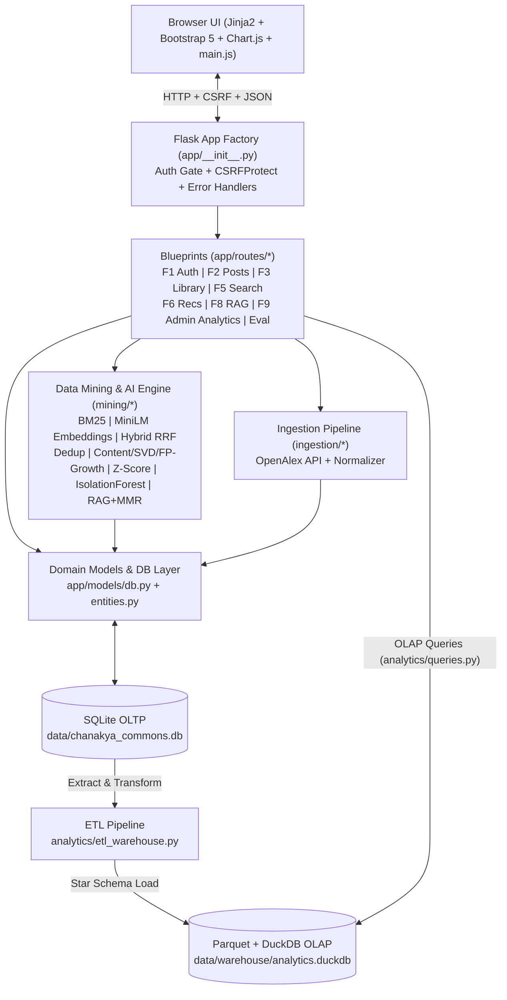
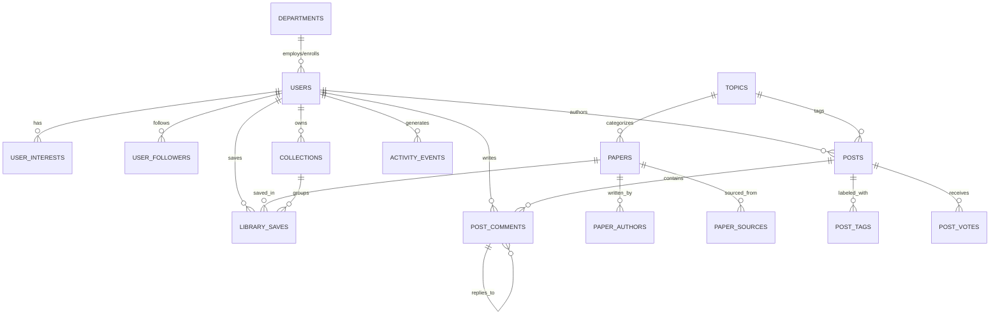
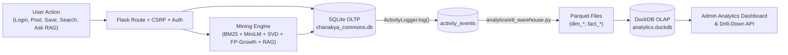

# Chanakya Research Commons — Complete Technical Documentation

**Course:** V Semester B.Tech Data Mining & Warehousing  
**Institution:** Chanakya University, Bangalore  
**Repository:** `https://github.com/JhansiCMohitha1587/ChanakyaResearchCommons` (Private)  
**Runtime Mode:** Localhost (`http://127.0.0.1:5000`) with SQLite + DuckDB & Parquet

---

## Table of Contents

1. [Chapter 1 — Project Overview](#chapter-1--project-overview)
2. [Chapter 2 — Complete Website Walkthrough](#chapter-2--complete-website-walkthrough)
3. [Chapter 3 — System Architecture](#chapter-3--system-architecture)
4. [Chapter 4 — Technologies and Tools](#chapter-4--technologies-and-tools)
5. [Chapter 5 — Database Design](#chapter-5--database-design)
6. [Chapter 6 — Data Mining Concepts](#chapter-6--data-mining-concepts)
7. [Chapter 7 — Algorithms and Mathematical Working](#chapter-7--algorithms-and-mathematical-working)
8. [Chapter 8 — Dataset and Data Sources](#chapter-8--dataset-and-data-sources)
9. [Chapter 9 — Backend Implementation](#chapter-9--backend-implementation)
10. [Chapter 10 — Frontend Implementation](#chapter-10--frontend-implementation)
11. [Chapter 11 — Admin Dashboard and Analytics](#chapter-11--admin-dashboard-and-analytics)
12. [Chapter 12 — Complete Data Flow](#chapter-12--complete-data-flow)
13. [Chapter 13 — Project Folder Structure](#chapter-13--project-folder-structure)
14. [Chapter 14 — Testing and Evaluation](#chapter-14--testing-and-evaluation)
15. [Chapter 15 — Local Setup and Demonstration](#chapter-15--local-setup-and-demonstration)
16. [Chapter 16 — Future Enhancements](#chapter-16--future-enhancements)
17. [Chapter 17 — Faculty Viva Preparation](#chapter-17--faculty-viva-preparation)

---

## Chapter 1 — Project Overview

### 1.1 Project Introduction
**Chanakya Research Commons** is a full-stack university academic research portal, literature discovery engine, collaborative discussion forum, and institutional data warehouse platform built in Python and Flask. It unifies operational scholarly workflows (OLTP) with analytical data mining and OLAP reporting in a self-contained localhost application.

### 1.2 Problem Statement
University students, faculty, and researchers often rely on fragmented tools: external paper portals for search, local folders for PDFs/notes, separate chat apps for research discussions, and spreadsheets for department tracking. This fragmentation makes it difficult to discover relevant papers, connect with peers working on similar topics, detect emerging research trends, or monitor institutional research engagement.

### 1.3 Motivation & Objectives
- **Unify** paper discovery, personal library curation, and scholarly discussions in one academic commons.
- **Apply** core Data Mining & Warehousing algorithms (Okapi BM25, dense sentence embeddings, Reciprocal Rank Fusion, TruncatedSVD, FP-Growth, Sliding-Window Z-Score trend detection, Isolation Forest anomaly detection, MMR-based RAG, and Star-Schema OLAP) on realistic university-scale data.
- **Enforce** role-based security, authentication-first route protection, CSRF protection, and privacy-preserving administrative analytics.

### 1.4 Scope, Target Users & Roles
- **Target Users:** University students, Ph.D./postdoc researchers, faculty members, and academic administrators.
- **Four User Roles (`users.role`):**
  1. `Student` — B.Tech / M.Tech students; can search, save papers, create collections, post, comment, reply, follow, and use recommendations & RAG assistant.
  2. `Researcher` — Ph.D. / PostDoc researchers; same member capabilities with researcher profile designation.
  3. `Faculty` — Faculty members; same member capabilities with faculty profile designation.
  4. `Admin` — Authorized administrators; full access to Institutional Analytics (`F9`), live record inspection, spam monitoring alerts, and dimensional OLAP drill-downs. Public registration strictly disallows `Admin`.

### 1.5 Nine Functional Subsystems
| Code | Subsystem | Primary Routes | Core Module(s) |
|---|---|---|---|
| **F1** | Accounts, Profiles & RBAC | `/login`, `/register`, `/logout`, `/profile`, `/settings`, `/follow` | `app/routes/auth_routes.py`, `app/models/entities.py` |
| **F2** | Posts, Comments & Discussions | `/community`, `/posts/<id>`, `/posts/create`, `/posts/<id>/comment`, `/posts/<id>/vote` | `app/routes/posts_routes.py`, `app/models/entities.py` |
| **F3** | Shared Research Library & Collections | `/library`, `/papers/<id>`, `/papers/save`, `/collections/create`, `/papers/import` | `app/routes/library_routes.py`, `app/models/entities.py` |
| **F4** | External Scholarly Ingestion | `/papers/import` + CLI `ingestion/openalex_ingestor.py` | `ingestion/openalex_ingestor.py`, `ingestion/normalizer.py` |
| **F5** | Unified 4-Panel Hybrid Search & Dedup | `/explore`, `/api/search` | `mining/search/*`, `mining/duplicate_detection/*` |
| **F6** | Multi-Model Recommendation Engine | `/recommendations`, `/api/recommendations` | `mining/recommendations/*` |
| **F7** | Trends & Anomaly Monitoring | `/analytics`, `/home` (trending topics) | `mining/trends/sliding_window.py`, `mining/anomaly_detection/spam_detector.py` |
| **F8** | RAG Research Assistant | `/assistant`, `/api/assistant/ask` | `mining/rag/*` |
| **F9** | Institutional Analytics & Warehouse | `/analytics`, `/analytics/records/<type>`, `/api/analytics/*` | `analytics/etl_warehouse.py`, `analytics/queries.py`, `analytics/admin_service.py` |

---

## Chapter 2 — Complete Website Walkthrough

### 2.1 Login & Registration (`/login`, `/register`, `/logout`)
- **What it does:** Serves as the mandatory authentication gate. Unauthenticated requests to `/` or any internal route redirect (`302`) to `/login` (and `/api/*` requests return `401`).
- **Frontend:** `app/templates/login.html` and `app/templates/register.html` extend `base.html` (which hides the sidebar and internal links when `current_user` is `None`).
- **Backend:** `app/routes/auth_routes.py` (`login()`, `register()`, `logout()`) + `app/__init__.py` (`enforce_authentication()`).
- **Database Tables:** `users`, `departments`, `user_interests`, `activity_events`.
- **Processing & Output:** `UserModel.create()` hashes passwords with `werkzeug.security.generate_password_hash()` and forces any non-member role to `Student`. `UserModel.authenticate()` verifies `check_password_hash()`, clears/sets the signed session cookie, logs a `login` event, and redirects to `/home`.

### 2.2 Member Home Dashboard (`/`, `/home`)
- **What it does:** Clean research-focused dashboard for authenticated users (without exposing global database statistics or admin metrics).
- **Frontend:** `app/templates/home.html` renders a welcome banner, main search bar, 4 quick-access cards (`Research Papers`, `For You`, `Community`, `Research Assistant`), `Popular Research Papers`, `Recent Community Discussions`, and `Trending Topics`.
- **Backend:** `home_dashboard()` in `app/__init__.py`.
- **Database Tables:** `papers`, `paper_authors`, `topics`, `library_saves`, `posts`, `users`, `departments`, `activity_events`.

### 2.3 Navigation Sidebar (`base.html`, `chanakya.css`, `main.js`)
- **What it does:** Collapsible left overlay sidebar, **closed by default**, toggled via the top-left hamburger button (`#sidebarToggle`). Clicking outside, pressing `Escape`, or clicking a link closes it automatically without page reload or shrinking page width.
- **Role-Based Item:** `Institutional Analytics` appears in the sidebar only when `current_user.role == 'Admin'`.

### 2.4 User Profiles & Follow Network (`/profile`, `/profile/<id>`, `/settings`, `/follow/<id>`, `/unfollow/<id>`)
- **What it does:** Displays member profile, department, bio, research interests, collections, recent saves, recent posts, followers/following lists, and AJAX follow/unfollow buttons.
- **Backend:** `auth_routes.py` (`my_profile`, `user_profile`, `settings`, `follow_user`, `unfollow_user`).
- **Database Tables:** `users`, `departments`, `user_interests`, `user_followers`, `collections`, `library_saves`, `posts`.

### 2.5 Explore & Unified 4-Panel Hybrid Search (`/explore`, `/api/search`)
- **What it does:** Searches across 4 panels simultaneously: (1) Scholarly Papers, (2) University Library Saved Papers, (3) University Members, and (4) Community Posts, with optional filters (`topic_id`, `year`, `department_id`).
- **Backend:** `app/routes/search_routes.py` calls `execute_unified_search()` in `mining/search/hybrid_ranker.py`.
- **Processing:** Combines Okapi BM25 (`BM25KeywordSearcher`) and 384-d cosine similarity (`SemanticPaperSearcher`) via Reciprocal Rank Fusion (`RRF_K = 60`), then queries `users` and `posts`. Logs a `search` event to `activity_events`.

### 2.6 Research Library, Paper Detail & Collections (`/library`, `/papers/<id>`, `/papers/save`, `/collections/create`, `/papers/import`)
- **What it does:** Switches between `University Repository (<dynamic count> Papers)` (paginated at 40 papers/page with topic & year filters) and `My Saved Papers` (with personal collections, private notes, and 1–5 star ratings).
- **Paper Detail (`/papers/<id>`):** Shows abstract, authors, source links, save form, and `"Members who saved this also saved"` (FP-Growth association rules via `get_also_saved_recommendations()`). Logs `view_paper` event.
- **Backend:** `app/routes/library_routes.py`, `PaperModel`, `LibraryModel`.
- **Database Tables:** `papers`, `paper_authors`, `paper_sources`, `library_saves`, `collections`, `topics`, `activity_events`.

### 2.7 Community Discussions (`/community`, `/posts/<id>`, `/posts/create`, `/posts/<id>/comment`, `/posts/<id>/vote`, `/posts/<id>/delete`)
- **What it does:** Displays `All Discussions` and `Following Feed`, allows creating posts (optionally attaching a saved paper and topic tags), upvoting via AJAX, reading threaded comments & nested replies, and adding comments or replies with live `comment_count` updates.
- **Backend:** `app/routes/posts_routes.py`, `PostModel`.
- **Database Tables:** `posts`, `post_tags`, `post_comments` (self-referencing `parent_comment_id`), `post_votes`, `activity_events`.

### 2.8 Recommendations (`/recommendations`, `/api/recommendations`)
- **What it does:** Provides personalized paper and collaborator recommendations using 3 methods: Content-Based Profile Matching, Collaborative Filtering (TruncatedSVD), and Cold-Start Popularity/Topic Fallback, plus Similar Researchers.
- **Backend:** `app/routes/rec_routes.py`, `mining/recommendations/content_based.py`, `mining/recommendations/collaborative.py`.

### 2.9 Research Assistant (RAG) (`/assistant`, `/api/assistant/ask`)
- **What it does:** Interactive Q&A chat where users ask academic questions and receive synthesized answers with inline citations `[1]`, `[2]` and expandable source passages.
- **Backend:** `app/routes/assistant_routes.py` -> `generate_rag_answer()` in `mining/rag/generator.py` -> `retrieve_relevant_passages()` -> `mmr_rerank_passages()`. Logs `ask_assistant` event.

### 2.10 Algorithm Benchmark Dashboard (`/evaluation`)
- **What it does:** Displays empirical evaluation metrics loaded from `reports/benchmarks_summary.json` comparing search rankers, duplicate detection, recommendation models, trend detection, spam detection, and RAG groundedness.
- **Backend:** `app/routes/evaluation_routes.py`.

### 2.11 Administrator Analytics & Record Inspection (`/analytics`, `/analytics/records/<record_type>`, `/api/analytics/records`, `/api/analytics/drilldown`)
- **What it does:** Strictly `@admin_required` dashboard showing live operational totals, filtered activity metrics, Chart.js visualizations, DuckDB OLAP dimensional drill-down, F7 topic spike alerts, F7 Isolation Forest spam alerts, and paginated/searchable record inspection (`papers`, `members`, `posts`, `comments`, `replies`, `saves`) with `password_hash` and `private_notes` excluded.
- **Backend:** `app/routes/analytics_routes.py`, `analytics/admin_service.py`, `analytics/queries.py`.

---

## Chapter 3 — System Architecture

Chanakya Research Commons follows a modular **Layered Flask Blueprint + Data Mining + Dual-Storage (OLTP + OLAP)** architecture:



---

## Chapter 4 — Technologies and Tools

| Category | Technology / Library | Purpose & Where Used |
|---|---|---|
| **Backend Framework** | Flask (`>=3.0.0`) | App factory (`create_app`), 8 Blueprints, Jinja2 rendering, session management. |
| **Security & Forms** | Werkzeug (`>=3.0.0`), Flask-WTF (`>=1.2.0`) | `pbkdf2:sha256` / `scrypt` password hashing (`entities.py`), `CSRFProtect` (`app/__init__.py`). |
| **Frontend UI** | Bootstrap 5.3.3, Bootstrap Icons, Chart.js 4.4.2 | Responsive cards, overlay sidebar (`base.html`, `chanakya.css`), admin charts (`analytics.html`). |
| **OLTP Database** | SQLite 3 (WAL mode, FK enforced) | Local operational database (`data/chanakya_commons.db`) via `app/models/db.py`. |
| **OLAP Warehouse** | DuckDB (`>=1.0.0`), PyArrow (`>=15.0.0`) | Columnar star-schema OLAP analytics & Parquet export (`analytics/etl_warehouse.py`, `queries.py`). |
| **Embeddings & NLP** | `sentence-transformers` (`all-MiniLM-L6-v2`), PyTorch | 384-d semantic vectors for papers, queries, and RAG passages (`mining/embeddings.py`). |
| **ML & Data Mining** | `scikit-learn`, `mlxtend`, `pandas`, `numpy`, `scipy` | `TruncatedSVD` (`collaborative.py`), `IsolationForest` (`spam_detector.py`), `fpgrowth` (`association_rules.py`). |
| **Graph & Ingestion** | `networkx`, `requests` | Cross-department/author utilities & OpenAlex REST API harvesting (`openalex_ingestor.py`). |

---

## Chapter 5 — Database Design

### 5.1 Dual-Database Architecture (OLTP vs OLAP)
- **Operational Database (OLTP — SQLite at `data/chanakya_commons.db`):** Normalized 18-table relational schema (`database/schema/sqlite_schema.sql`) with `PRAGMA foreign_keys = ON` and `PRAGMA journal_mode = WAL`, optimized for fast point reads/writes (login, posting, commenting, saving papers).
- **Analytical Warehouse (OLAP — DuckDB at `data/warehouse/analytics.duckdb` + Apache Parquet):** Star-schema dimensional model (`dim_user`, `dim_department`, `dim_paper`, `dim_topic`, `dim_time`, `fact_research_activity`) optimized for vectorized aggregations and multi-level drill-downs.

### 5.2 All 18 Operational Tables (SQLite)

| # | Table | Primary Key | Key Columns & Foreign Keys |
|---|---|---|---|
| 1 | `departments` | `id` | `code` (UNIQUE), `name`, `description`, `faculty_count` |
| 2 | `users` | `id` | `username` (UNIQUE), `email` (UNIQUE), `password_hash`, `full_name`, `role`, `department_id` -> `departments.id`, `is_spam_flagged` |
| 3 | `user_interests` | `id` | `user_id` -> `users.id`, `topic_name`, `weight` (UNIQUE `(user_id, topic_name)`) |
| 4 | `user_followers` | `id` | `follower_id` -> `users.id`, `following_id` -> `users.id` (UNIQUE pair) |
| 5 | `topics` | `id` | `name` (UNIQUE), `slug` (UNIQUE), `domain`, `follower_count`, `post_count` |
| 6 | `topic_followers` | `id` | `user_id` -> `users.id`, `topic_id` -> `topics.id` |
| 7 | `papers` | `id` | `title`, `clean_title`, `abstract`, `publication_year`, `doi` (UNIQUE), `arxiv_id` (UNIQUE), `venue`, `citation_count`, `primary_topic_id` -> `topics.id`, `embedding_json` |
| 8 | `paper_authors` | `id` | `paper_id` -> `papers.id`, `author_name`, `normalized_name`, `affiliation`, `author_order` |
| 9 | `paper_sources` | `id` | `paper_id` -> `papers.id`, `source_name`, `external_id`, `landing_url`, `pdf_url`, `raw_payload_path` |
| 10 | `collections` | `id` | `user_id` -> `users.id`, `title`, `description`, `is_public` |
| 11 | `library_saves` | `id` | `user_id` -> `users.id`, `paper_id` -> `papers.id`, `collection_id` -> `collections.id`, `private_notes`, `rating` (1–5) |
| 12 | `posts` | `id` | `user_id` -> `users.id`, `title`, `content`, `attached_paper_id` -> `papers.id`, `primary_topic_id` -> `topics.id`, `upvote_count`, `comment_count`, `is_pinned` |
| 13 | `post_tags` | `id` | `post_id` -> `posts.id`, `tag_name` |
| 14 | `post_comments` | `id` | `post_id` -> `posts.id`, `user_id` -> `users.id`, `parent_comment_id` -> `post_comments.id` (self-FK for nested replies), `content` |
| 15 | `post_votes` | `id` | `post_id` -> `posts.id`, `user_id` -> `users.id`, `vote_value` (`-1` or `1`) |
| 16 | `activity_events` | `id` | `user_id` -> `users.id`, `event_type`, `target_type`, `target_id`, `metadata_json`, `created_at` |
| 17 | `search_history` | `id` | `user_id` -> `users.id`, `query_text`, `result_count`, `created_at` |
| 18 | `recommendations_cache` | `id` | `user_id` -> `users.id`, `rec_type`, `item_id`, `score`, `explanation` |

### 5.3 Entity-Relationship Diagram



---

## Chapter 6 — Data Mining Concepts

Every concept below is audited directly against the repository source code:

| Concept | Status | Implementation File & Symbol | Summary |
|---|---|---|---|
| **Data Collection & Ingestion** | **Fully Implemented** | `ingestion/openalex_ingestor.py` (`harvest_openalex_works`) | Fetches scholarly works from OpenAlex REST API, saves raw JSON to `data/raw/`, and normalizes records. |
| **ETL (Extract-Transform-Load)** | **Fully Implemented** | `analytics/etl_warehouse.py` (`run_etl`) | Extracts OLTP tables, builds Star Schema dimensions + weighted fact rows, writes Parquet + DuckDB. |
| **ELT** | **Not Implemented** | — | Project uses Python-side ETL prior to loading DuckDB/Parquet rather than in-warehouse SQL transforms. |
| **Data Cleaning & Preprocessing** | **Fully Implemented** | `ingestion/normalizer.py` (`normalize_title`, `extract_doi`, `extract_arxiv_id`, `clean_author_name`) | Lowercases, strips punctuation/accents, extracts canonical DOIs/arXiv IDs, reconstructs OpenAlex inverted abstracts. |
| **Data Integration** | **Fully Implemented** | `ingestion/openalex_ingestor.py`, `app/routes/library_routes.py` | Merges records across `OpenAlex`, `arXiv`, `SyntheticCorpus`, and `Manual` into unified `papers` + `paper_sources`. |
| **Deduplication** | **Fully Implemented** | `mining/duplicate_detection/paper_dedup.py` (`are_papers_duplicate`, `detect_all_duplicates`) | Multi-signal deduplication: exact DOI/arXiv ID match (`conf=1.0`), exact normalized title (`0.98`), Jaccard (`>=0.85`) + Levenshtein (`>=0.90`). |
| **MinHash & LSH** | **Not Implemented** | — | Deduplication uses exact token-set Jaccard + Levenshtein ratio rather than MinHash signatures or LSH buckets. |
| **Entity Resolution** | **Fully Implemented** | `mining/duplicate_detection/author_resolution.py` (`resolve_author_entities`, `jaro_winkler_similarity`) | Resolves author name variants (e.g. `"A. Deshpande"` vs `"Aarav Deshpande"`) using Jaro-Winkler (`>=0.88`) and initial+surname matching. |
| **Keyword Search & Okapi BM25** | **Fully Implemented** | `mining/search/keyword_search.py` (`BM25KeywordSearcher`) | Builds inverted index over paper titles (2x weight) + abstracts; scores with Okapi BM25 (`k1=1.5`, `b=0.75`). |
| **Text Embeddings & Vector Search** | **Fully Implemented** | `mining/embeddings.py`, `mining/search/semantic_search.py` (`SemanticPaperSearcher`) | Encodes text into 384-d L2-normalized `all-MiniLM-L6-v2` vectors; performs exact dot-product cosine similarity over `embedding_json`. |
| **Vector Stores (Dedicated)** | **Partially Implemented** | `papers.embedding_json` (`TEXT` column) | Vectors are persisted as JSON arrays in SQLite and loaded into NumPy matrices in memory (no FAISS/pgvector runtime index). |
| **Reciprocal Rank Fusion (RRF)** | **Fully Implemented** | `mining/search/hybrid_ranker.py` (`reciprocal_rank_fusion`) | Merges BM25 and Dense Semantic rank lists using `1 / (60 + rank)`. |
| **Content-Based Filtering** | **Fully Implemented** | `mining/recommendations/content_based.py` (`recommend_papers_content_based`) | Builds user interest/save centroid vector in 384-d space and ranks unsaved papers by cosine similarity + topic boost. |
| **Collaborative Filtering** | **Fully Implemented** | `mining/recommendations/collaborative.py` (`MatrixFactorizationCF`) | Applies `sklearn.decomposition.TruncatedSVD` (`n_components=12`) on User × Paper save/rating matrix. |
| **Association Rule Mining (FP-Growth)** | **Fully Implemented** | `mining/recommendations/association_rules.py` (`FPGrowthCoSaveRecommender`) | Uses `mlxtend` `fpgrowth` (`min_support=0.04`, `max_len=2`) + `association_rules` (`min_confidence=0.35`) for `"also saved"`. |
| **Sliding-Window Trend Detection** | **Fully Implemented** | `mining/trends/sliding_window.py` (`compute_sliding_window_trends`) | Compares 14-day current velocity against 45-day weekly baseline mean/std using Z-score & growth rate. |
| **Stream Mining** | **Partially Implemented** | `mining/trends/sliding_window.py` | Simulates sliding-window velocity over timestamped `activity_events` rather than a live Kafka/Flink event stream. |
| **Anomaly Detection (Isolation Forest)** | **Fully Implemented** | `mining/anomaly_detection/spam_detector.py` (`detect_spam_accounts`) | Extracts 6 behavioral features per user and runs `sklearn.ensemble.IsolationForest` + heuristic rules. |
| **RAG & MMR Re-Ranking** | **Fully Implemented** | `mining/rag/retriever.py`, `ranker.py`, `generator.py` | Retrieves top-20 papers -> splits abstracts into passages -> re-ranks with Maximal Marginal Relevance (`lambda=0.70`) -> extractive/Ollama synthesis with citations. |
| **PageRank & Clustering** | **Not Implemented** | — | Not implemented in the codebase. |

---

## Chapter 7 — Algorithms and Mathematical Working

### 7.1 Okapi BM25 (`mining/search/keyword_search.py`)
For query $Q$ and document $D$ (where title tokens are weighted $2\times$):
$$\text{IDF}(q_i) = \ln\left(\frac{N - df(q_i) + 0.5}{df(q_i) + 0.5} + 1\right)$$
$$\text{BM25}(D, Q) = \sum_{q_i \in Q} \text{IDF}(q_i) \cdot \frac{tf(q_i, D) \cdot (k_1 + 1)}{tf(q_i, D) + k_1 \cdot \left(1 - b + b \cdot \frac{|D|}{\text{avgdl}}\right)}$$
with $k_1 = 1.5$, $b = 0.75$.

### 7.2 Cosine Similarity & Reciprocal Rank Fusion (`mining/search/hybrid_ranker.py`)
- **Cosine Similarity (on L2-normalized 384-d vectors):** $\text{sim}(\mathbf{q}, \mathbf{d}) = \mathbf{q} \cdot \mathbf{d}$.
- **RRF Score ($k = 60$):**
  $$\text{RRF}(d) = \sum_{m \in \{\text{BM25}, \text{Semantic}\}} \frac{1}{60 + \text{rank}_m(d)}$$
  *Example:* A paper ranked #1 in BM25 and #4 in Semantic gets $\frac{1}{61} + \frac{1}{64} = 0.01639 + 0.01563 = 0.03202$.

### 7.3 TruncatedSVD Collaborative Filtering (`mining/recommendations/collaborative.py`)
Given sparse User × Paper matrix $R \in \mathbb{R}^{m \times n}$ (explicit rating $1..5$ or implicit $1.0$):
$$R \approx U_k \Sigma_k V_k^T, \quad k = \min(12, \min(m, n) - 1)$$
Predicted affinity for user $u$ on unsaved paper $p$ is $\hat{R}_{u,p} = (U_k \Sigma_k)_u \cdot (V_k^T)_{:,p}$.

### 7.4 FP-Growth Association Rules (`mining/recommendations/association_rules.py`)
For paper baskets $A \Rightarrow B$ (`min_support = 0.04`, `min_confidence = 0.35`):
$$\text{support}(A \cup B) = \frac{|\{u : A \in B_u \land B \in B_u\}|}{N}, \quad \text{confidence}(A \Rightarrow B) = \frac{\text{support}(A \cup B)}{\text{support}(A)}, \quad \text{lift}(A \Rightarrow B) = \frac{\text{confidence}(A \Rightarrow B)}{\text{support}(B)}$$

### 7.5 Sliding-Window Z-Score Trend Detection (`mining/trends/sliding_window.py`)
For each topic, let $v_{\text{curr}}$ be the weekly event rate over the last `window_days` ($14$ days), and $\mu_{\text{base}}, \sigma_{\text{base}}$ be the mean and standard deviation of weekly counts in the preceding `baseline_days` ($45$ days):
$$Z = \frac{v_{\text{curr}} - \mu_{\text{base}}}{\sigma_{\text{base}}}, \quad \text{Growth\%} = \frac{v_{\text{curr}} - \mu_{\text{base}}}{\max(\mu_{\text{base}}, 1)} \times 100$$
A spike is flagged when $(\text{Growth\%} \ge 100 \land Z \ge z_{\text{threshold}})$ or $\text{Growth\%} \ge 180$.

### 7.6 Isolation Forest Anomaly Detection (`mining/anomaly_detection/spam_detector.py`)
Extracts 6 features per user: `[post_count, comment_count, save_count, keyword_hits, burst_ratio, avg_upvotes]` (where `burst_ratio` is fraction of consecutive posts $< 2$ hours apart). Fits `IsolationForest(contamination=0.10, random_state=42)` and flags accounts where `pred == -1` and (`keyword_hits >= 2` or `burst_ratio >= 0.4` or `post_count >= 15`), or `keyword_hits >= 3`.

### 7.7 Maximal Marginal Relevance (MMR) (`mining/rag/ranker.py`)
With $\lambda = 0.70$:
$$\text{MMR}(c_i) = \lambda \cdot \text{sim}(c_i, Q) - (1 - \lambda) \cdot \max_{s \in S} \text{sim}(c_i, s)$$

---

## Chapter 8 — Dataset and Data Sources

### 8.1 Current Verified Database Counts (`data/chanakya_commons.db`)
- **Departments (`9`):** `CSE`, `DSAI`, `ISE`, `ECE`, `BTBI`, `MDS`, `CYBR`, `ROBO`, `PHYS`.
- **Users (`934`):** `755` Student, `100` Researcher, `76` Faculty, `3` Admin.
- **Topics (`104`):** Across AI, CS, IT, Electronics, Biotechnology, Management, Cybersecurity, Robotics, Quantum & Physics.
- **Papers (`1,100`):** `520` seeded scholarly records (tagged with `OpenAlex` / `arXiv` source metadata) + `580` `SyntheticCorpus` records; all with 384-d `embedding_json`.
- **Authors (`2,492`):** Linked via `paper_authors`.
- **Community:** `5,036` posts, `15,208` comments/replies (`11,456`+ top-level comments, `3,747`+ replies), `9,996` post tags, `5,445` post votes.
- **Library & Activity:** `817` collections, `10,527` `library_saves`, `2,533` `user_followers`, `10,200` `search_history`, `66,966` `activity_events` spanning **184 days (27 weeks)**.
- **Ground Truth Evaluation Sets (`data/synthetic/`):** 40 duplicate pairs, 5 planted spam accounts, 1 planted QML topic spike, author resolution pairs, search queries, and RAG benchmarks.

---

## Chapter 9 — Backend Implementation

- **App Factory (`app/__init__.py`):** `create_app(config_name)` configures storage dirs, `CSRFProtect`, `teardown_appcontext(close_db)`, Jinja filters (`truncate_chars`, `format_date`), global `before_request` authentication gate (`enforce_authentication`), 8 blueprints, `/home` dashboard, and `404`/`500` handlers.
- **Database Layer (`app/models/db.py`):** `get_connection()`, `query_db()`, `execute_db()`, `execute_script()`, plus dialect helpers `sql_group_concat()`, `sql_date_format()`, `sql_date_cast()`.
- **Domain Models (`app/models/entities.py`):** `UserModel`, `PaperModel`, `LibraryModel`, `PostModel`, `ActivityLogger`.
- **Security:** `werkzeug.security` password hashing, `HttpOnly` + `SameSite=Lax` session cookies, `CSRFProtect`, `@login_required`, `@admin_required`, and open-redirect validation on `next` URLs.

---

## Chapter 10 — Frontend Implementation

- **Base Layout (`app/templates/base.html`):** Top bar with left hamburger button (`#sidebarToggle`), collapsible overlay left sidebar (`#leftSidebar`, closed by default), user dropdown, flash messages, and minimal footer (`Chanakya Research Commons`).
- **Styling (`app/static/css/chanakya.css`):** Navy-blue (`#0f172a` -> `#1e3a8a`) and gold (`#d97706`) academic theme, `.crc-sidebar` slide-over transition, `.academic-card`, `.kpi-card`.
- **Client JavaScript (`app/static/js/main.js`):** Automatic CSRF token injection into all `POST` forms and `fetch()` calls, sidebar open/close/outside-click/Escape handling, AJAX upvotes, AJAX follow/unfollow, and assistant query chips.

---

## Chapter 11 — Admin Dashboard and Analytics

Accessible strictly to `Admin` users via `/analytics` and `/analytics/records/<record_type>`:
- **Global Filters:** Start/End Date, Department, Role, Topic, Activity Type.
- **Clickable KPI Cards:** Total Papers, Total Members (with Student/Faculty/Researcher/Admin breakdown), Total Posts, Total Comments, Total Replies, Total Library Saves — each opens `/analytics/records/<type>` with search, sort, filters, and pagination (excluding `password_hash` and `private_notes`).
- **Visualizations (Chart.js):** Monthly/Weekly/Daily Activity & Active Members line chart, Member Role donut chart, Department Comparison bar chart, Papers by Source bar chart.
- **OLAP & Monitoring:** DuckDB Star-Schema Dimensional Drill-Down (`University -> Department -> Topic -> Member`), F7 Sliding-Window Topic Spikes, Cross-Department Collaboration Network, and F7 Isolation Forest Spam Monitoring.

---

## Chapter 12 — Complete Data Flow



---

## Chapter 13 — Project Folder Structure

```
ChanakyaResearchCommons/
├── app/
│   ├── __init__.py                  # App factory, auth gate, CSRF, error handlers, /home
│   ├── config.py                    # Development, Testing, Production configs
│   ├── models/                      # db.py (SQLite/PG adapter) & entities.py
│   ├── routes/                      # 8 Blueprints (auth, posts, library, search, rec, assistant, analytics, evaluation)
│   ├── static/                      # css/chanakya.css & js/main.js
│   └── templates/                   # 16 Jinja2 HTML templates
├── analytics/                       # etl_warehouse.py, queries.py, admin_service.py
├── data/                            # Local SQLite DB (gitignored), synthetic/ ground truth, warehouse/ Parquet & DuckDB
├── database/                        # schema/ (sqlite_schema.sql, postgres_schema.sql) & seeds/
├── evaluation/                      # 6 eval scripts + run_all_evaluations.py
├── ingestion/                       # openalex_ingestor.py & normalizer.py
├── mining/                          # embeddings.py, search/, duplicate_detection/, recommendations/, trends/, anomaly_detection/, rag/
├── reports/                         # benchmarks_summary.json, evaluation_metrics.csv, specs
├── scripts/                         # init_db.py, setup_local_db.py, generate_synthetic_data.py, verify_dataset.py, etc.
├── tests/                           # test_all_subsystems.py (13 unit & integration tests)
├── .env.example                     # Safe local environment template
├── .gitignore                       # Excludes .env, .venv, *.db, *.duckdb, __pycache__
├── requirements.txt                 # Python dependencies
└── README.md                        # Quick start & teammate setup guide
```

---

## Chapter 14 — Testing and Evaluation

- **Automated Subsystem Suite (`tests/test_all_subsystems.py`):** 13/13 tests passing (registration/auth, RBAC, posts, comments/votes, saves, ingestion normalizer, unified search, duplicate detection, recommendations, trend detection, spam detection, RAG, DuckDB analytics).
- **Benchmark Results (`reports/benchmarks_summary.json`):**
  - Search: BM25 `P@5=0.6100, nDCG@10=0.6043`; Hybrid RRF `P@5=0.3600, nDCG@10=0.3598`.
  - Duplicate Detection: `Precision=1.0000, Recall=0.7500, F1=0.8571`.
  - Collaborative Filtering (SVD): `P@5=0.7120, Coverage=38.65%` (vs Popularity Baseline `P@5=0.5200, Coverage=1.92%`).
  - Trend Spike Detection: `Precision=1.0000, Recall=1.0000, F1=1.0000, Mean Delay=3.2d`.
  - Spam Detection: `Precision=0.8333, Recall=1.0000, F1=0.9091, Accuracy=0.9833`.
  - RAG Research Assistant: `Groundedness=1.0000`.
- **Known Limitations:** `BM25KeywordSearcher` and `SemanticPaperSearcher` cache indices in-memory per process; `recommendations_cache` and `topic_followers` tables exist in schema but are currently `0` rows (recommendations are computed on-demand).

---

## Chapter 15 — Local Setup and Demonstration

See `README.md` (`Running Chanakya Research Commons Locally`) for full macOS, Windows, and Linux instructions.
**Quick Start (existing local environment):**
```bash
.venv/bin/python -m flask --app app:create_app run --host=127.0.0.1 --port=5000
```
Open `http://127.0.0.1:5000`.

**Suggested Faculty Demo Sequence:**
1. Open `http://127.0.0.1:5000` (shows login-first gate).
2. Log in as a Student -> show clean Home page, left hamburger sidebar, Explore 4-panel search, Research Library (`1,100` papers), Recommendations (`For You`), Community post/comment/reply, and Research Assistant RAG citations.
3. Log out and log in as Admin (`chetan.joshi8`) -> open `Institutional Analytics` from the sidebar -> demonstrate KPI cards, clickable Record Inspection (`/analytics/records/papers`), filters, DuckDB OLAP drill-down, Trend Spikes, and Isolation Forest Spam Alerts.

---

## Chapter 16 — Future Enhancements

- Real-time incremental index updates for BM25/Semantic search when new papers are added.
- Populating `recommendations_cache` via scheduled background jobs.
- Dedicated vector index (`faiss` / `pgvector`) for >100k paper scaling.
- Full local LLM synthesis via Ollama (`USE_OLLAMA=true`).

---

## Chapter 17 — Faculty Viva Preparation

1. **Q: Why did you use both SQLite and DuckDB?**
   - *Short:* SQLite handles fast transactional writes (OLTP), while DuckDB + Parquet handles fast analytical aggregations (OLAP).
   - *Detail:* Row-oriented SQLite excels at single-user lookups (login, saving a paper, adding a comment). Columnar DuckDB scans only needed columns across 66,966 `fact_research_activity` rows in milliseconds for dashboards and drill-downs.
2. **Q: Explain Reciprocal Rank Fusion (RRF) in your search engine.**
   - *Short:* RRF combines rankings from BM25 keyword search and dense semantic vector search using $\sum \frac{1}{60 + \text{rank}}$.
   - *Detail:* BM25 and cosine similarity have incompatible score scales. RRF relies only on ranks, smoothing top-rank dominance via $k=60$ so papers strong in both lexical and semantic relevance rise to the top.
3. **Q: How does your Recommendation Engine solve Cold Start?**
   - *Short:* New users with no saves receive popular/department-aligned papers via `get_cold_start_recommendations()`.
   - *Detail:* Once a user has saves/interests, Content-Based filtering builds a 384-d centroid vector and TruncatedSVD Collaborative Filtering predicts latent preferences; FP-Growth (`min_support=0.04`, `min_confidence=0.35`) powers `"Members who saved this also saved"`.
4. **Q: How do you detect spam bots and topic spikes?**
   - *Short:* Isolation Forest detects anomalous users; Sliding-Window Z-Score detects topic surges.
   - *Detail:* `spam_detector.py` extracts 6 behavioral features (including `<2h` burst ratio and spam keywords) and runs `IsolationForest`. `sliding_window.py` compares 14-day velocity against a 45-day baseline using $Z = (v - \mu)/\sigma$.
5. **Q: How does your RAG Research Assistant prevent hallucinations?**
   - *Short:* It retrieves top-20 papers semantically, splits abstracts into passages, re-ranks with MMR ($\lambda=0.70$), and synthesizes answers strictly from retrieved passages with `[1]`, `[2]` citations.
6. **Q: How is security enforced in your Flask app?**
   - *Short:* Global `before_request` login gate, `werkzeug.security` password hashing, `CSRFProtect` on all POST/fetch requests, `@admin_required` RBAC, and `private_notes` / `password_hash` exclusion in admin inspection.
